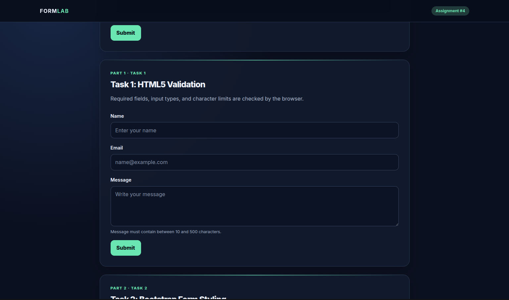
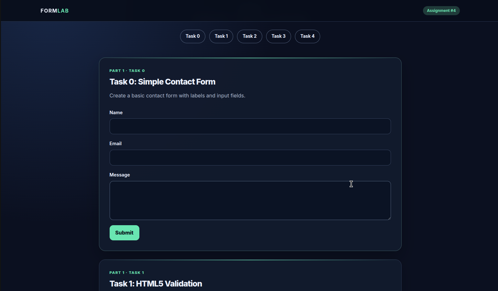
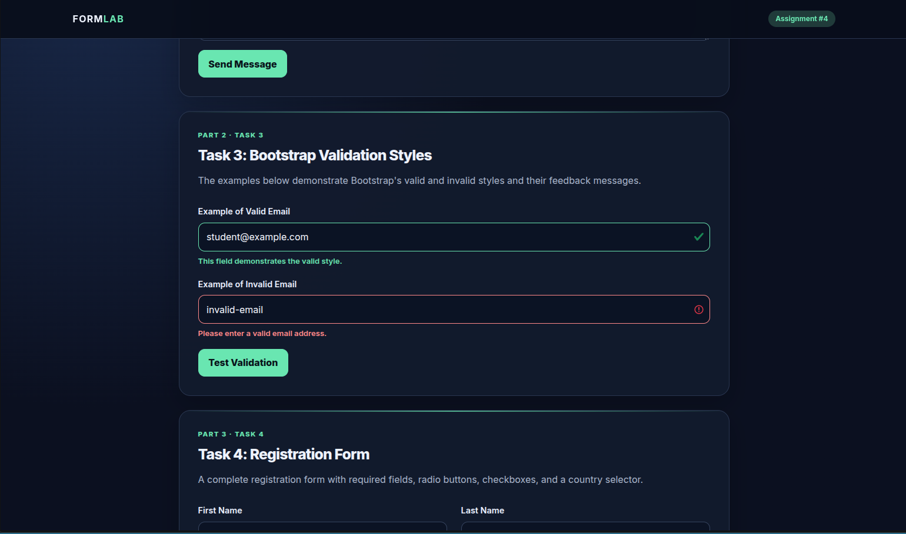
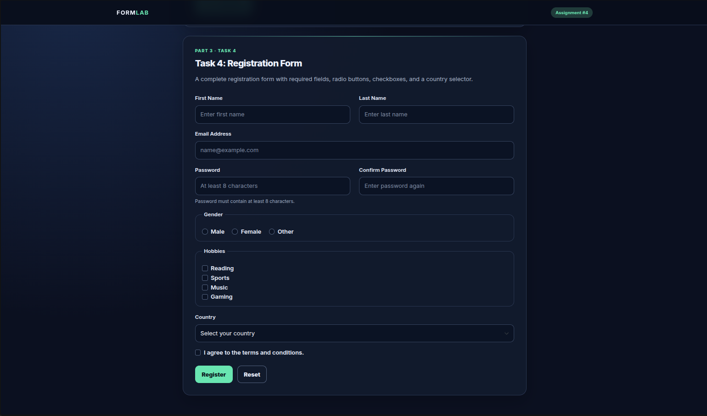

# Assignment-4-WebTech
Assignment 4 — Forms and Validation

Askar Bavgashev
SE_2540

About the Project

This project demonstrates how to create and style HTML forms using HTML5 and Bootstrap. It covers basic form creation, built-in HTML validation, Bootstrap form styling, validation feedback, and a registration form with different input types.

The project is built with HTML and CSS, using Bootstrap 5.3.3 for responsive layouts and form components.

Tasks

Task 0: Simple Contact Form
Creates a basic contact form with name, email, and message fields, along with a submit button.

Task 1: HTML5 Validation
Demonstrates built-in browser validation using HTML attributes such as required, minlength, maxlength, and type="email".

Task 2: Bootstrap Form Styling
Uses Bootstrap form controls and a responsive grid to organize the form fields and improve the layout.

Task 3: Bootstrap Validation Styles
Demonstrates Bootstrap's valid and invalid input styles, including feedback messages for email fields.

Task 4: Registration Form
Contains a registration form with first name, last name, email, password, password confirmation, gender selection, hobbies, country selection, and terms acceptance.

Technologies Used

HTML5
CSS3
Bootstrap 5.3.3
Google Fonts (Inter)
Project Structure

Assignment4/
├── index.html
├── styles.css
└── README.md

index.html — contains the page structure, all five tasks, and the form elements.
styles.css — contains the custom website design, colors, spacing, form styling, and responsive adjustments.
README.md — provides information about the project and instructions for running it.
How to Run the Project
Download or clone the project repository.
Make sure index.html and styles.css are in the same folder.
Open index.html in a web browser.
Use the navigation buttons to move between the five tasks.
An internet connection is required to load Bootstrap from its CDN and Google Fonts.

Features

Five form and validation examples.
HTML5 built-in form validation.
Bootstrap form controls and responsive layout.
Valid and invalid input styling.
Multiple input types, including text fields, email fields, password fields, radio buttons, checkboxes, and a country dropdown.
Custom dark theme with mint-green accents.
Responsive layout for different screen sizes.